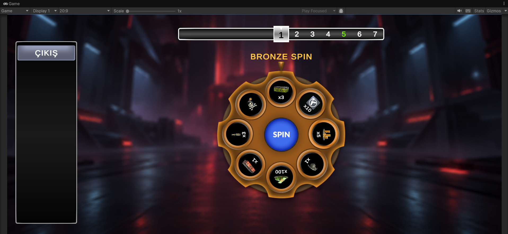
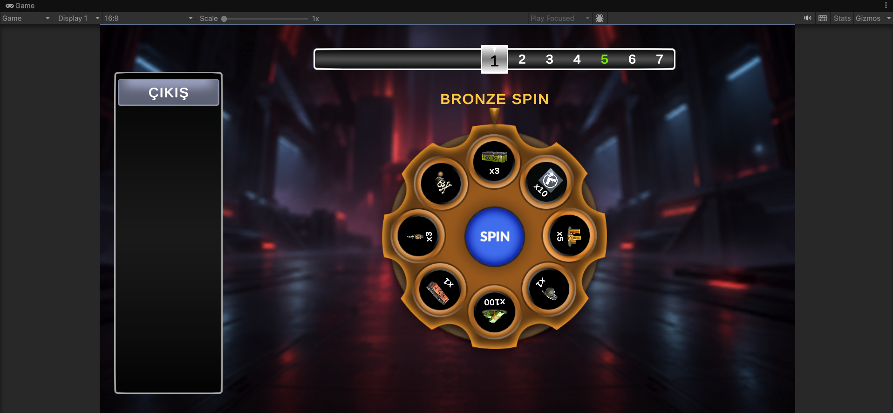
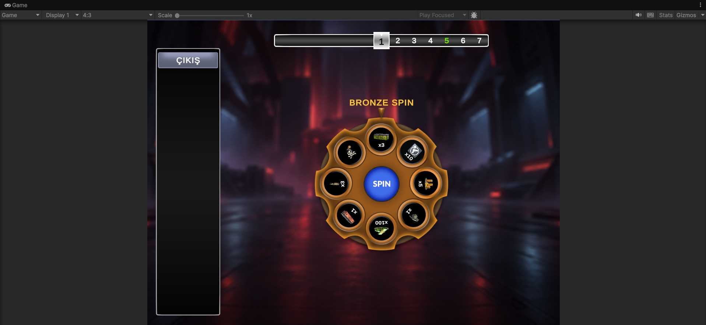

# Spin Game

Unity ile geliştirilmiş, Android odaklı bir ödül çarkı demosu. Oyuncu her bölgede
çarkı çevirerek ödül biriktirir; bomba gelirse tur boyunca topladığı ödülleri kaybeder.
Çark beklerken oyundan çıkarak biriken ödüllerin özetini görebilir.

**Unity:** 6000.3.23f1 LTS · **Platform:** Android · **Giriş:** Dokunmatik / mouse

[Oynanış videosu](docs/videos/gameplay.mp4) · [Android build ve kurulum rehberi](ANDROID_BUILD.md)

## Ekran görüntüleri

Görseller, Unity Game penceresinde seçilen üç ekran oranındaki yerleşimi gösterir.
Editör araç çubuğu görüntülere dahildir.

| 20:9 | 16:9 | 4:3 |
| --- | --- | --- |
|  |  |  |

## Oynanış

1. **Başla!** ile 1. bölgede, boş envanterle yeni bir tur başlar.
2. **SPIN** çarkı döndürür. Ödül gelirse soldaki listeye eklenir; aynı ödülün miktarı artar.
3. **Devam** bir sonraki bölgeye geçirir ve yeni bir çark oluşturur.
4. Çark beklerken **ÇIKIŞ**, toplanan ödüllerin özetini açar.
5. Bomba gelirse bütün tur kazancı silinir ve bomba ekranı açılır.
6. Ana menüye dönüldüğünde tur sıfırlanır. Bir sonraki oyun tekrar 1. bölgeden başlar.

| Bölge | Çark | İçerik |
| --- | --- | --- |
| Normal bölgeler | Bronze | Yedi ödül ve bir bomba |
| Her 5. bölge | Silver | Sekiz ödül; bomba bulunmaz |
| Her 30. bölge | Golden | Sekiz özel ödül; bomba bulunmaz |

30'un katlarında Golden çark önceliklidir. İlerleyen bölgelerde ödül miktarlarına
bölgeye bağlı bir artış uygulanır. Kalıcı kayıt ve para ile devam sistemi bu demoda yer almaz.

**Çıkış kuralı:** Teknik talimatlardaki, oyuncunun her spin öncesinde kazançlarıyla
ayrılabileceği açıklaması esas alınmıştır. Bu nedenle çıkış, bütün bölgelerde çark
beklerken kullanılabilir.

## Projeyi çalıştırma

1. Bu depoyu bilgisayarına klonla veya ZIP olarak indirip çıkar.
2. Unity Hub üzerinden depo kökünü proje olarak ekle.
3. Projeyi **Unity 6000.3.23f1** ile aç ve paketlerin yüklenmesini bekle.
4. `Assets/Scenes/FinaleDemo.unity` sahnesini aç.
5. **Play** düğmesine bas.

Android APK üretmek için Unity Hub kurulumunda **Android Build Support**, **Android
SDK & NDK Tools** ve **OpenJDK** bileşenleri gerekir. Kaydedilmiş build ayarları
IL2CPP ve ARM64 + ARMv7 ile tek APK üretir. Paket kimliği `com.ali.spindemo`'dur.

APK dağıtımı GitHub **Releases** üzerinden `SpinDemo.apk` dosyasıyla yapılır.
Kaynaktan build alma ve telefona kurma adımları [Android rehberinde](ANDROID_BUILD.md) açıklanmıştır.

## Teknik yapı

Oyun akışı, tur verileri, ödül üretimi ve UI sunumu ayrı sınıflarda tutulur.

| Bileşen | Sorumluluk |
| --- | --- |
| `FinaleGameController` | Menü, spin, ödül, bölge geçişi, bomba ve özet akışını yönetir. |
| `RunSession` | Bölge ve biriken ödülleri bellekte tutar; yeni turda sıfırlar. |
| `SpinRewardPool` | ScriptableObject üzerinden çarkın ödüllerini, miktar seçeneklerini ve görsellerini tanımlar. |
| `SpinRewardGenerator` | Havuzdan tekrarsız ödül seçer, miktar belirler ve çark dilimlerini karıştırır. |
| `WheelSpinner` | Rastgele başlangıç hızı seçer ve sabit yavaşlamayla çarkı döndürür. |
| `SpinDetector`, `SpinSlot` | Dönüş bitince Physics2D sorgusuyla üstteki kazanan deliği belirler. |
| `CollectedItemsPanel`, `CollectedItemRow` | Ödül listesini ve miktarların birleştirilmesini yönetir. |
| `ZoneBarController` | Bölge barının DOTween animasyonunu ve geçiş tamamlanma bildirimini yönetir. |
| `PopupTransition`, `BombExplosionPanel` | Ödül, özet ve bomba pencerelerinin geçişlerini yönetir. |
| `BackgroundMusicPlayer` | Arka plan müziğini döngüde, yumuşak ses geçişleriyle çalar. |

### Ödül ve spin ayarları

- Bronze, Silver ve Golden ödül havuzları `Assets/UI/PossibleItems/Data` altındadır.
  Ödül ikonları ve olası miktarlar Inspector üzerinden düzenlenebilir.
- Çark sekiz dilimlidir. Aynı çarkta bir ödül kimliği birden fazla kez seçilmez.
- `FinaleGameController` üzerindeki **Reward Growth Per Zone** varsayılan olarak
  `0.05`'tir. Miktar hesabı: `ceil(temel miktar × (1 + (bölge - 1) × artış oranı))`.
- Her spin sıfır dönüş açısından başlar. Sekiz başlangıç hızının her biri eşit,
  `1/8` olasılıkla seçilir. Kazanan delik dönüş sonunda fizik sorgusuyla algılanır.
- Dönüş açısı, o karedeki başlangıç ve bitiş hızlarının ortalaması kullanılarak hesaplanır.

### UI, animasyon ve ses

- uGUI, TextMeshPro ve 1920×1080 referans çözünürlüğünde **Canvas Scaler / Expand** kullanılır.
- Arka plan, **Aspect Ratio Fitter / Envelope Parent** ile ekranı doldurur.
- Çerçevelerde Sliced sprite'lar; bölüm barı ve pencerelerde DOTween kullanılır.
- Buton referansları `OnValidate` ile atanır; dinleyiciler koddan eklenip kaldırılır.
- Input System'in `InputSystemUIInputModule` bileşeni dokunmatik ve mouse girişlerini işler.
- Oyun iki yatay ekran yönünü destekler.
- `AudioSystem` üzerindeki 2D AudioSource menü ve oyun boyunca çalmaya devam eder.
  Her müzik döngüsünde 2 saniye fade-in ve 3 saniye fade-out uygulanır. Müzik
  Vorbis / Streaming olarak içe alınır; ses geçişleri `Time.timeScale` değerinden bağımsızdır.

### Sprite Atlas

Sprite Atlas V2 etkindir. `Assets/Atlases` altında iki atlas bulunur:

- `RewardsAtlas.spriteatlasv2`: Ödül ve bomba ikonları.
- `UIAtlas.spriteatlasv2`: Çark, gösterge, buton ve çerçeve sprite'ları.

Atlaslar build'e dahildir. UI uyumluluğu için rotation, tight packing ve mipmap
kapalıdır; padding 4 piksel, maksimum boyut 2048, Android sıkıştırması ASTC 6×6'dır.
Büyük arka plan ve TMP font atlasları ayrı tutulur.

`Assets/Editor/FinaleSpriteAtlasBuilder.cs`, build öncesinde atlasları otomatik yeniler.

## Doğrulama

Editor ve Device Simulator üzerinde şu akışlar kontrol edildi:

- Spin sonucu ödül kazanma, envantere ekleme ve aynı ödülün miktarını artırma.
- Gerçek dönüşlerle 30. bölgeye ilerleme; Silver bölgeleri ve Golden önceliği.
- Bölge barının animasyonla ilerlemesi.
- Kazançlarla çıkış, doğru özet ve ana menüden temiz bir tur başlatma.
- Ödül kazandıktan sonra bomba gelmesi ve bütün tur kazancının silinmesi.
- Ödül kazanmadan çıkış ve boş özet ekranı.
- 20:9, 16:9 ve 4:3 ekran yerleşimleri.
- Samsung Galaxy S10 5G simülasyonunda Input System touch press/release olaylarıyla
  Başla, Spin, Devam, Çıkış, özet ve bomba ekranı etkileşimleri.

Android IL2CPP APK derlemesi 24 Ekim 2026 tarihinde **0 hata ve 1 eskime uyarısıyla**
tamamlandı; APK imzası doğrulandı. Bu sonuç, bütün Android cihazlarda performans
ve davranış doğrulaması yapıldığı anlamına gelmez.

## Bilinen sorunlar ve build notları

- Mevcut Android build'inde üst durum çubuğunun sürekli görünmesi raporlandı;
  bu sorun henüz giderilmedi.
- `SpinDetector` içindeki `ContactFilter2D.NoFilter()` çağrısı eskime uyarısı üretir.
- Unity Pipeline 0.9.0-exp.1 paketinin Android build ön işlemindeki `Subtarget`
  hatası için paket proje içine alınmış ve düzeltilmiştir.
  `Packages/com.unity.pipeline` klasörü projenin bir parçasıdır.
  Ayrıntılar: [Pipeline Android düzeltmesi](PIPELINE_ANDROID_FIX.md).
